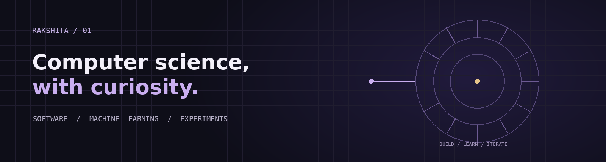

  

# hey, i'm rakshita

Computer science student exploring the space between software engineering and machine learning. I like building practical things, understanding how they work, and learning through experiments.

[Portfolio](https://rakshitahooda.github.io/portfolio/) · [LinkedIn](https://www.linkedin.com/in/rakshita-hooda) · [GitHub](https://github.com/rakshitahooda)

## 01 / selected work

**[KnowSphere AI](https://github.com/rakshitahooda/knowsphere-ai)** 
A local-first document assistant built around retrieval-augmented generation. It indexes documents and connects answers to source passages. 
`Python` `FastAPI` `React` `ChromaDB` `Ollama`

**[Job Scheduling System](https://github.com/rakshitahooda/job-scheduling-system)** 
An interactive look at scheduling algorithms, from greedy strategies to weighted interval scheduling. 
`Python` `JavaScript` `Algorithms`

**[GitHub Pixel Art](https://github.com/rakshitahooda/github-pixel-art)** 
An interactive pixel-art project built around a grid. 
`JavaScript` `Creative coding`

## 02 / toolkit

**Languages** · Python, C++, SQL, JavaScript 
**Data & ML** · Pandas, NumPy, scikit-learn 
**Tools** · Git, GitHub, VS Code, Jupyter

## 03 / in progress

Building stronger foundations in machine learning, algorithms and reliable software—one experiment at a time.

learning, building, and figuring things out.
